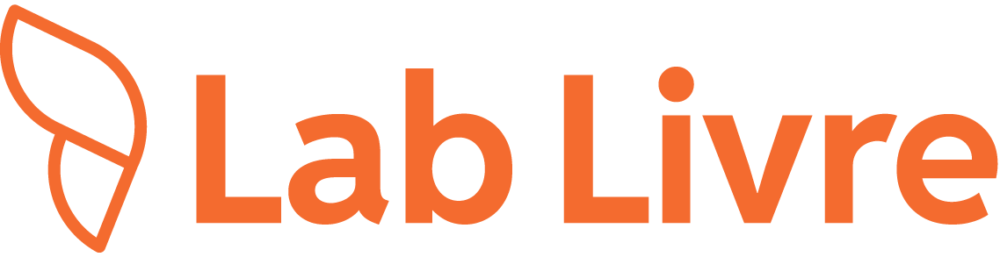

<div align="center">
  
</div>

# OmniAuth gov.br

[English](README.md) | **Português (Brasil)**

[](https://gitlab.com/lappis-unb/decidimbr/components-brasil-participativo/omniauth-govbr/-/commits/main)
[](https://rubygems.org/gems/omniauth-govbr)
[](LICENSE.txt)

Estratégia OmniAuth OAuth2 não oficial para login com gov.br.

O `omniauth-govbr` permite que qualquer aplicação Rack ou Rails autentique usuários com a conta gov.br, o serviço de
login único do governo federal brasileiro (Login Único). A gem implementa o fluxo authorization code do OpenID Connect
com PKCE em `sso.acesso.gov.br` e converte os dados do usuário gov.br em um auth hash padrão do OmniAuth. Foi feita para
implantações federais, como a plataforma Brasil Participativo, e a aplicação precisa estar cadastrada no gov.br para
obter um client ID e um client secret.

> **Não oficial.** Este projeto não é afiliado nem endossado pelo governo federal ou pela equipe do gov.br
> (Secretaria de Governo Digital).

## Sumário

- [Funcionalidades](#funcionalidades)
- [Compatibilidade](#compatibilidade)
- [Instalação](#instalação)
- [Configuração](#configuração)
- [Uso](#uso)
- [Privacidade e dados](#privacidade-e-dados)
- [Desenvolvimento](#desenvolvimento)
- [Contribuindo](#contribuindo)
- [Segurança](#segurança)
- [Mantenedores](#mantenedores)
- [Licença](#licença)

## Funcionalidades

- Login com gov.br pelo fluxo padrão do OmniAuth em `/auth/govbr`.
- Fluxo authorization code com PKCE ativado por padrão.
- Auth hash com o CPF do usuário (como `uid`), nome, email e um apelido gerado.
- Funciona com os ambientes de produção e de homologação (staging) do gov.br.

## Compatibilidade

| omniauth-govbr | OmniAuth | Ruby |
|---|---|---|
| 0.1.x | OmniAuth 2.x, omniauth-oauth2 1.8+ | >= 3.0 |

## Instalação

```bash
bundle add omniauth-govbr
```

## Configuração

Registre o provider em um initializer, por exemplo `config/initializers/omniauth.rb`:

```ruby
Rails.application.config.middleware.use OmniAuth::Builder do
  provider :govbr, ENV["GOVBR_CLIENT_ID"], ENV["GOVBR_CLIENT_SECRET"],
           scope: "openid email profile",
           client_options: { site: ENV.fetch("GOVBR_SITE", "https://sso.acesso.gov.br") }
end
```

| Opção | Padrão | Descrição |
|---|---|---|
| `scope` | nenhum | Escopos do gov.br separados por espaço. Use `openid email profile`; adicione `govbr_confiabilidades` para ler os níveis de confiabilidade da conta. |
| `pkce` | `true` | Envia o code challenge PKCE, exigido pelo gov.br. |
| `client_options[:site]` | `https://sso.staging.acesso.gov.br` | Host do SSO gov.br. Use `https://sso.acesso.gov.br` em produção. |
| `client_options[:authorize_url]` | `/authorize` | Caminho do endpoint de autorização. |
| `client_options[:token_url]` | `/token` | Caminho do endpoint de token. |
| `client_options[:user_info_url]` | `/userinfo` | Caminho do endpoint de dados do usuário. |

A gem não lê variáveis de ambiente. As variáveis abaixo são só os nomes usados no exemplo acima.

| Variável de ambiente | Obrigatória | Descrição |
|---|---|---|
| `GOVBR_CLIENT_ID` | sim | Client ID emitido pelo gov.br para a sua aplicação. |
| `GOVBR_CLIENT_SECRET` | sim | Client secret emitido pelo gov.br para a sua aplicação. |
| `GOVBR_SITE` | não | Host do SSO gov.br, por exemplo `https://sso.staging.acesso.gov.br` durante os testes. |

A URI de redirecionamento cadastrada no gov.br deve ser `https://<seu-host>/auth/govbr/callback`.

## Uso

Envie o usuário para `/auth/govbr` com uma requisição POST (o OmniAuth 2 bloqueia GET por padrão):

```erb
<%= button_to "Entrar com gov.br", "/auth/govbr", method: :post, data: { turbo: false } %>
```

Depois do login, o gov.br redireciona para `/auth/govbr/callback` e `request.env["omniauth.auth"]` contém:

```ruby
{
  provider: "govbr",
  uid: "12345678900",               # "sub" do gov.br, o CPF do usuário
  info: {
    sub: "12345678900",
    name: "Maria da Silva",
    nickname: "maria_da_silva",     # nome em minúsculas, espaços trocados por "_"
    email: "maria@example.com",
    locale: nil,
    cpf: "12345678900"              # apenas dígitos
  },
  credentials: { token: "...", expires_at: 1_700_000_000, expires: true },
  extra: { raw_info: { ... } }      # resposta completa do endpoint /userinfo
}
```

## Privacidade e dados

A gem não armazena nada. A cada login ela recebe dados pessoais do gov.br e os repassa à aplicação no auth hash: CPF
(`uid`, `info.sub`, `info.cpf`), nome completo, email e tudo o mais que o endpoint `/userinfo` retornar em
`extra.raw_info` (por exemplo telefone e foto de perfil, conforme os escopos concedidos). O CPF é dado pessoal pela
LGPD (Lei nº 13.709/2018). A aplicação decide o que guardar, por quanto tempo e com qual base legal; guarde só o
necessário.

## Desenvolvimento

```bash
bin/setup
bundle exec rake   # testes + rubocop
```

## Contribuindo

Contribuições são bem-vindas. Leia o [CONTRIBUTING.md](CONTRIBUTING.md) antes de abrir um merge request. Ele cobre a
configuração do ambiente, a convenção de commits, a política de idioma (inglês para código, commits e merge requests;
textos de interface em `en` e `pt-BR`) e as verificações que precisam passar.

Bugs e ideias vão no [issue tracker](https://gitlab.com/lappis-unb/decidimbr/components-brasil-participativo/omniauth-govbr/-/issues).
Este projeto segue o [Código de Conduta](CODE_OF_CONDUCT.md).

## Segurança

**Não reporte vulnerabilidades em issues públicas.** Veja o [SECURITY.md](SECURITY.md) para as versões suportadas e
como reportar de forma privada (issue confidencial no GitLab ou TODO-TEAM-EMAIL).

## Mantenedores

Mantido pelo [LAPPIS — Universidade de Brasília](https://lappis.rocks) para a plataforma Brasil Participativo.

- Paulo Tada (TODO-GITLAB-HANDLE)
- TODO-MAINTAINER-2

Veja o [CHANGELOG.md](CHANGELOG.md) para o histórico de versões.

## Licença

Disponível como código aberto nos termos da [Licença MIT](LICENSE.txt).
